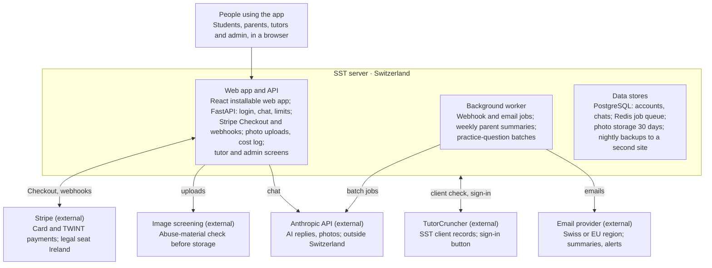
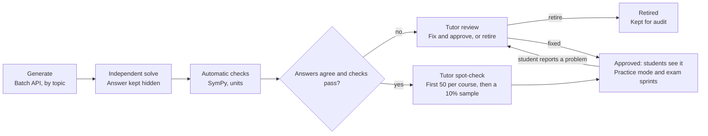

# SST Virtual Tutor – build plan

Oct 28, 2026 · @Chris

## Purpose and scope

The SST Virtual Tutor is a subscription web app that gives secondary-school students an AI tutor for homework and revision, with a one-tap route to SST's human tutors. It runs on a Swiss-hosted server owned by SST, takes payment through Stripe (card and TWINT), and is free for students already taking lessons with SST. It replaces the existing SST IB Maths app.

**Who uses it**

- **Students** (about 11 to 19) studying for IB, international and Swiss school qualifications: they chat with the tutor, practise questions and escalate to a human.
- **Parents**: they create the account, pay, add one or more children and receive progress summaries.
- **SST tutors**: they answer escalated questions and review generated practice questions.
- **SST admin**: manages users, subscriptions, content, safeguarding flags and costs.

**The first version must**

1. Let a parent sign up, add students and subscribe by card or TWINT.
2. Give students a chat tutor for the launch subjects that guides rather than hands over answers, renders maths properly and accepts a photo of their working.
3. Enforce plan limits and record usage and cost per student.
4. Let a student send a question to a human tutor and receive the reply in the app and by email.
5. Give admin a dashboard of users, subscriptions, usage, cost and flagged conversations.

**Out of scope for the first version**: native App Store and Google Play apps, live video lessons inside the app (lessons stay with SST's existing booking process) and automated marking of full exam papers. Writing coursework for students (Internal Assessments, Extended Essays, TOK essays) is out of scope permanently.

## Links and brand

The app lives on a subdomain of swisssciencetutors.ch and sends people to the main site for anything about lessons. The site has no terms or privacy pages today, so these must exist before launch.

| Page | Link | Used in the app for |
| --- | --- | --- |
| Home | [swisssciencetutors.ch](https://swisssciencetutors.ch/) | Logo link and footer |
| Book a free consultation | [/book-a-consultation/](https://swisssciencetutors.ch/book-a-consultation/) | Main call to action for lessons and the hybrid tier |
| How we operate | [/how-we-operate/](https://swisssciencetutors.ch/how-we-operate/) | "Lessons with a tutor" explainer |
| Find a tutor | [/find-a-tutor/](https://swisssciencetutors.ch/find-a-tutor/) | Link under every Ask-a-tutor answer |
| Our tutors | [/our-tutors/](https://swisssciencetutors.ch/our-tutors/) | Tutor profile links in escalation replies |
| About us | [/about-us/](https://swisssciencetutors.ch/about-us/) | Footer |
| FAQ | [/frequently-asked-questions/](https://swisssciencetutors.ch/frequently-asked-questions/) | Help menu |
| Contact | [/contact/](https://swisssciencetutors.ch/contact/) | Support link |
| Blog | [/blog/](https://swisssciencetutors.ch/blog/) | Footer |
| Areas we cover | [/areas-we-cover/](https://swisssciencetutors.ch/areas-we-cover/), plus [Zurich](https://swisssciencetutors.ch/location/zurich/), [Geneva](https://swisssciencetutors.ch/location/geneva/), [Lausanne](https://swisssciencetutors.ch/location/lausanne/), [Basel](https://swisssciencetutors.ch/location/basel/), [Zug](https://swisssciencetutors.ch/location/zug/) | Footer, and in-person lesson upsell |
| Maths | [/maths/](https://swisssciencetutors.ch/maths/), with [IB Maths](https://swisssciencetutors.ch/maths/ib-maths/), [A Level Maths](https://swisssciencetutors.ch/maths/a-level-maths/), [IGCSE Maths](https://swisssciencetutors.ch/igcse-maths/), [Swiss Matura Maths](https://swisssciencetutors.ch/swiss-matura-maths/), [French Bac Maths](https://swisssciencetutors.ch/french-bac-maths/), [EPFL & ETH entrance maths](https://swisssciencetutors.ch/epfl-eth-entrance-maths/) | "Learn more" links in the subject picker |
| Physics, Chemistry, Biology | [/physics/](https://swisssciencetutors.ch/physics/), [/chemistry/](https://swisssciencetutors.ch/chemistry/), [/biology/](https://swisssciencetutors.ch/biology/) | "Learn more" links in the subject picker |
| Existing SST IB Maths app | [App Store](https://apps.apple.com/us/app/sst-ib-maths/id6444309821), [Google Play](https://play.google.com/store/apps/details?id=com.kikodo.ibmaths) | Retirement notice pointing users to the new app |

**Pages to add to the main site before launch**

- `/virtual-tutor/`: landing page with plans and prices.
- `/terms/`: terms of use, including subscription, renewal and cancellation terms.
- `/privacy/`: privacy notice under the revised Swiss data protection act (revFADP).
- `/ai-safety/`: how the tutor uses AI, safeguarding, and a public statement of child-safety and privacy compliance. The AI provider asks organisations serving minors to state this publicly.

**Address and email**

- App address: a subdomain such as `tutor.swisssciencetutors.ch`, with `staging.tutor.swisssciencetutors.ch` for testing.
- Domain email runs on Google Workspace. Send app email through a transactional email provider, with SPF, DKIM and DMARC set on the domain.
- Senders: `tutor@` for app mail; `billing@` stays with the existing QR-bill invoice emails.

**Brand**

- Take the logo, colours and fonts from the main site; Chris supplies the source files.
- Interface copy in British English (the site says "Maths"), plus German and French.
- Tone: warm, encouraging and plain-spoken, never patronising.

## Subjects covered

Launch with IB Diploma Maths and Physics, then widen to the other sciences and curricula SST already teaches, then to new IB subjects once SST has tutors for them. The site lists Maths, Physics, Chemistry and Biology across IB, A Level, IGCSE, Swiss Maturité, French Bac and entrance exams ([how we operate](https://swisssciencetutors.ch/how-we-operate/), [maths](https://swisssciencetutors.ch/maths/)).

| Curriculum | Courses | Language | SST teaches it today | Phase |
| --- | --- | --- | --- | --- |
| IB Diploma | Maths: Analysis and Approaches SL/HL, Applications and Interpretation SL/HL; Physics SL/HL | English | Yes | 1 (launch) |
| IB Diploma | Chemistry SL/HL, Biology SL/HL | English | Yes | 2 |
| IB Diploma core | Coaching on the process of Internal Assessments and Extended Essays in maths and sciences; TOK discussion practice. Never writing assessed work | English | New | 2 |
| IGCSE | Maths, Physics, Chemistry, Biology | English | Yes | 2 |
| A Level | Maths, Further Maths, Physics, Chemistry, Biology | English | Yes | 2 |
| IB MYP | Mathematics (standard and extended), Sciences | English | New | 3 |
| Swiss Matura / Maturité | Maths, Physics, Chemistry, Biology | German or French | Yes | 3 |
| French Baccalauréat | Mathématiques, Physique-chimie, SVT | French | Yes | 3 |
| University entrance | EPFL and ETH entrance maths, CMS, Cours Euler, first-year university maths | French, German or English | Yes | 3 |
| Interview preparation | Oxford and Cambridge maths and science interviews, as a mock-interview mode | English | Yes | 3 |
| IB Diploma | Computer Science SL/HL, Environmental Systems and Societies, Sports Exercise and Health Science, Design Technology | English | New | 3, once SST has a tutor for each |

**Rules for every course**

- AI tutoring goes live for a course only when its curriculum module is written (topic list, command terms, notation, calculator rules) and its evaluation set passes.
- Ask-a-tutor opens for a course only when at least two SST tutors are tagged for it, so questions are covered during holidays.
- Store per course: exam board, course code, level, syllabus edition, teaching language and first exam year. Confirm the current edition on the board's own site before writing the module.
- Reference syllabus topics by name and code only. Never copy syllabus text, past papers or mark schemes into prompts or the question bank.
- Which IGCSE and A Level boards to support first (Cambridge, Pearson Edexcel, AQA, OCR) is an open decision.

## Product tiers and pricing

AI-only costs CHF 24 a month or CHF 199 a year, hybrid costs CHF 149 a month, and two add-ons are sold one-off. Existing SST lesson students get AI-only free. All prices live in Stripe and are looked up by key, never hard-coded.

| Plan | Price (CHF) | Includes | Stripe lookup key | Fair-use limit |
| --- | --- | --- | --- | --- |
| AI-only, monthly | 24 per month | AI tutor and practice for all enabled courses; weekly parent summary | `ai_monthly` | 300 tutor messages a month, 60 a day |
| AI-only, annual | 199 per year | As monthly | `ai_annual` | As monthly |
| Hybrid | 149 per month | Everything in AI-only, plus 1 hour a month with an SST tutor (booked through SST) and a monthly progress note from that tutor | `hybrid_monthly` | 500 messages a month, 80 a day |
| Ask a tutor | 19 per question | A written answer from an SST tutor within 24 hours | `ask_tutor_single` | None |
| IB exam sprint | 349 one-off | February to May revision plan, timed paper-style sets, 3 hours of tutor marking of mock papers | `exam_sprint` | None |
| SST lesson students | Free | AI-only features while the family has lessons with SST | None: automatic for active TutorCruncher clients; admin or invite code for exceptions | 300 messages a month |

**Rules**

- Prices are per student. A family with two children has one subscription with a quantity of two. A sibling discount is an open decision.
- AI-only and hybrid start with a 7-day free trial. The payment method is collected at sign-up and the trial converts automatically unless cancelled.
- Limits are set per plan in the admin area. At 80% of the monthly limit the student sees a notice; at 100% they are offered the hybrid plan or Ask a tutor. A reply in progress is never cut off.
- Prices are shown VAT-inclusive if SST is VAT-registered; VAT treatment is an open decision for SST's accountant.
- Internal costing for the admin dashboard: lesson price CHF 120 an hour, tutor pay CHF 60 an hour, and 10 minutes of tutor time (CHF 10) budgeted per Ask-a-tutor answer. The scenarios and break-even figures are in the pricing model spreadsheet, SST\_AI\_Tutor\_pricing\_model.xlsx.

## Architecture and hosting



Everything about a family is stored on SST's server in Switzerland. Only chat content and photos go to the AI provider, and payments run through Stripe. The server also reads SST's client records from the TutorCruncher API and accepts sign-ins from TutorCruncher.

**Components**

| Component | Choice | Notes |
| --- | --- | --- |
| Front end | React, TypeScript and Vite; installable web app (PWA); KaTeX for maths | Interface in en-GB, de-CH and fr-CH |
| API | Python 3.12, FastAPI, Pydantic 2 | Server-sent events stream tutor replies |
| Database | PostgreSQL 16 with SQLAlchemy 2 and Alembic | Nightly encrypted backups to a second Swiss site |
| Background jobs | Worker on a Redis-backed queue | Webhooks, emails, summaries, question batches |
| File storage | S3-compatible object storage in Switzerland | Photos deleted after 30 days |
| Web server | Caddy | Automatic TLS certificates |
| Hosting | A small virtual server at a Swiss provider (Infomaniak or Exoscale), plus a staging copy | Fits the CHF 80 a month assumed in the pricing model; move the database to a managed service as usage grows |

**Repository layout**

```text
app/      FastAPI: api, auth, billing, llm, tutoring, practice, escalation, admin, safety
worker/   background jobs
prompts/  versioned base instructions and course modules
web/      React front end
evals/    tutor evaluation suite
infra/    Docker Compose, Caddy, backup scripts
docs/     PLAN.md, PROGRESS.md, DECISIONS.md, runbooks
```

**Environment variables**

| Variable | Purpose |
| --- | --- |
| `DATABASE_URL`, `REDIS_URL` | Database and job queue |
| `ANTHROPIC_API_KEY` | AI provider key, server only |
| `TUTOR_MODEL`, `FAST_MODEL` | Model IDs |
| `STRIPE_SECRET_KEY`, `STRIPE_WEBHOOK_SECRET`, `STRIPE_API_VERSION` | Payments |
| `S3_ENDPOINT`, `S3_BUCKET`, `S3_ACCESS_KEY`, `S3_SECRET_KEY` | Photo storage |
| `EMAIL_API_KEY`, `EMAIL_FROM` | Transactional email |
| `SCREENING_API_KEY` | Image screening service |
| `TUTOR_NAME`, `DISCLOSE_MODEL_PROVIDER` | Persona and disclosure |
| `APP_BASE_URL`, `MAIN_SITE_URL` | `https://tutor.swisssciencetutors.ch`, `https://swisssciencetutors.ch` |
| `AI_MONTHLY_BUDGET_CHF`, `AI_STUDENT_ALERT_CHF` | Cost alerts |
| `TUTORCRUNCHER_API_KEY, TUTORCRUNCHER_SSO_KEY` | Matching SST families and the TutorCruncher sign-in button |

## Accounts and roles

Parents own accounts and pay. Every under-18 student account is created by a parent; adults aged 18 and over sign up and pay for themselves.

| Role | Who | Can | Sign-in |
| --- | --- | --- | --- |
| Parent | Payer and legal guardian | Subscribe, add and remove students, read summaries, manage billing, export or delete the family's data | Email link or password, email verified; optional authenticator-app 2FA; SST families can also arrive from TutorCruncher |
| Student (under 18) | Child linked to a parent | Chat, practise, use Ask a tutor with family credits, see own progress | Username and password set by the parent, or an invite link to the student's own email |
| Adult learner | 18 and over, for example EPFL or ETH entrance students | Parent and student rights combined | Email and password |
| Tutor | SST tutor | Ask-a-tutor queue and question review for their tagged courses; own time log | Email, password and mandatory 2FA |
| Admin | Chris and delegated staff | Everything, including the safeguarding queue and entitlements | Email, password and mandatory 2FA |

**Parent sign-up**

1. Enter email, set a password and verify the email address.
2. Confirm being the student's parent or legal guardian; accept the terms and privacy notice. Store the version accepted and the timestamp.
3. Add each student: first name or nickname, year of birth (not full date of birth), curriculum, courses and preferred language.
4. Choose a plan and pay through Stripe Checkout. Access starts when the Stripe webhook confirms payment, not on the redirect back.
5. The student receives their login, either credentials set by the parent or an invite link.

**Rules**

- The age check is the year of birth plus the parent's declaration. Students under 18 cannot register themselves.
- Existing SST families get free access automatically: at sign-up and every night, the server checks the parent's email against active clients in the TutorCruncher API and links each child to their TutorCruncher student record. Access ends when the family stops being an active client. Admin-issued invite codes remain for exceptions.
- Use a maintained authentication library with Argon2id password hashing; no hand-written cryptography.
- Sessions use HttpOnly, Secure, SameSite=Lax cookies, with CSRF protection, login rate limiting and single-use password-reset tokens valid for 30 minutes.
- Student names, emails and other identifiers never leave SST's server. AI calls carry an internal ID only.
- Parents can download the family's data and delete accounts themselves. Deletion removes chats, photos and progress within 30 days, keeping only the billing records SST must retain by law.
- Tutors see a student's first name, course and the excerpt the student chose to share, never contact details. All tutor–family contact stays inside the app.

**Signing in with TutorCruncher** (Phase 1)

- SST families never need a second password. Parents and adult learners can sign in with a one-time link sent to their email (single use, valid 15 minutes) instead of a password; passwords stay available for anyone who prefers them.
- A "Virtual Tutor" button in TutorCruncher's menu uses TutorCruncher's single sign-on (System > Settings > TutorCruncher API > SSO Configuration). The app verifies TutorCruncher's token, matches the TutorCruncher user ID to the linked account and signs the person in.
- Roles map as: TutorCruncher client to parent, student (service recipient) to student, contractor to tutor. Tutors and admin still complete the app's own 2FA.
- Build the button only once TutorCruncher has confirmed how its tokens are signed and verified (see Open decisions). Until then it stays switched off and the email link covers everyone.
- The app stores only TutorCruncher IDs and email addresses and copies no lesson or billing data. The TutorCruncher API key stays on the server.

## Payments with Stripe

Stripe Billing runs every subscription and one-off payment in CHF, by card or TWINT. The app stores only Stripe IDs and grants access from webhooks, never from the browser redirect.

**Setup**

- One Stripe account for Swiss Science Tutors GmbH in CHF. Test mode until Chris approves go-live, with separate webhook endpoints for staging and production.
- Payment methods: cards and TWINT. Stripe added TWINT for subscriptions and Checkout subscription mode in API version 2026-05-27.dahlia ([changelog](https://docs.stripe.com/changelog/dahlia/2026-05-27/recurring-payments-twint)); pin that version or later.
- TWINT allows one active mandate per merchant–customer pair. Each family is therefore one Stripe customer with one subscription, and a second child raises the quantity.
- Stripe-hosted Checkout: `subscription` mode for plans, `payment` mode for add-ons. The app never handles card data.
- The Stripe Customer Portal handles plan changes, payment methods, cancellation and invoice downloads.
- Upgrades from AI-only to hybrid apply immediately with proration; downgrades apply at the end of the period.

**Webhooks**

| Event | What the app does |
| --- | --- |
| `checkout.session.completed` | Link the Stripe customer and subscription to the family; for add-ons, add a tutor credit or start the exam sprint |
| `customer.subscription.created`, `customer.subscription.updated` | Update plan, quantity, status and period end, then recompute access |
| `customer.subscription.deleted` | Remove paid access at the end of the period |
| `customer.subscription.trial_will_end` | Remind the parent that the trial is ending (Stripe sends it three days before) |
| `invoice.paid` | Record the payment and clear any payment warning |
| `invoice.payment_failed` | Email the parent and start a 7-day grace period |

Verify every webhook signature, store each event ID and ignore repeats, process events in a background worker, and reconcile against the Stripe API nightly.

**Access by subscription status**

| Stripe status | Access |
| --- | --- |
| `trialing`, `active` | Full access for the plan |
| `past_due` | Full access for 7 days, then read-only with a payment banner |
| `canceled`, `unpaid`, `incomplete_expired` | Read-only: past chats and progress, no new messages |

**Also**

- Phase 3: annual plans paid by QR-bill, reusing SST's existing QR-bill invoice pipeline. Access starts when the payment is matched in the bank's camt.054 file.
- Monthly CSV of Stripe payouts, fees and refunds in the format SST imports into Banana Accounting.
- Prices are VAT-inclusive. A Swiss VAT rate is applied only if the accountant confirms SST must charge it on this service.
- An Ask-a-tutor credit is refunded automatically if the 24-hour turnaround is missed.
- Test with the Stripe CLI for local webhooks and test clocks for trials, renewals and failed payments.

## AI tutor engine and persona

The tutor is a server-side service calling the Anthropic API: Sonnet 5.5 for tutoring and reading photos, Haiku 5.5 for routing, screening and summaries. Every call goes through one module that adds caching, limits and cost logging.

| Job | Model | Why |
| --- | --- | --- |
| Tutoring replies, reading homework photos, marking structured answers | Sonnet 5.5 | Strong maths and science reasoning at mid-tier price: USD 2 input, USD 10 output per million tokens |
| Topic routing, safety pre-screen, conversation titles, parent summaries | Haiku 5.5 | Fast and cheap: USD 0.10 input, USD 0.50 output per million tokens for prompts up to 100,000 tokens |
| Generating and verifying practice questions | Sonnet 5.5 through the Batch API | Half price for work that can wait |

Prices from Anthropic's [pricing page](https://platform.claude.com/docs/en/about-claude/pricing), checked 28 October 2026. Model IDs live in environment variables (`TUTOR_MODEL`, `FAST_MODEL`); take the current IDs from Anthropic's [models overview](https://platform.claude.com/docs/en/models/overview).

**Prompt layers, top to bottom**

1. Base instructions: persona, teaching method, safety and academic-integrity rules, language and formatting. One versioned file.
2. Course module: topic list with codes, command terms, notation, units, calculator rules, common misconceptions and SL/HL differences. Written or approved by SST tutors; one file per course.
3. Student context: course, level, language, current topic and recent weak topics. No name.
4. The conversation: the last 20 turns plus a running summary of earlier ones.

Layers 1 and 2 use [prompt caching](https://platform.claude.com/docs/en/build-with-claude/prompt-caching); a Sonnet 5.5 cache read costs USD 0.10 per million tokens.

**Teaching behaviour**

- Start by asking what the student has tried, or which step is stuck.
- Give one hint at a time and check understanding before moving on.
- Show a full worked solution only after the student has attempted the problem or asked twice, then offer a similar question to try.
- Match the level (SL or HL, MYP or DP) and use the curriculum's command terms, such as "show that" and "hence".
- Be strict about units, significant figures and the curriculum's notation.
- Write maths in LaTeX for KaTeX to render. Keep replies short; no essays.
- Reply in the student's language (English, German or French), with British spelling in English.
- Praise effort, correct mistakes plainly, never mock.
- Stay on schoolwork and study skills, steering off-topic chat back politely.
- Decline to write Internal Assessments, Extended Essays, TOK essays or anything the student says is assessed. Offer coaching on the process and remind them of their school's rules on AI.
- After three hints without progress, or when the request needs a person, offer Ask a tutor or a lesson.

**Homework photos**

- Accept JPEG, PNG and HEIC up to 10 MB; convert HEIC to JPEG and strip EXIF metadata, including location.
- Screen every upload for child sexual abuse material before storing or forwarding it (see Safeguarding).
- Keep photos in Swiss object storage for 30 days, then delete them.
- Send photos to the model as [image input](https://platform.claude.com/docs/en/build-with-claude/vision). For handwriting, the tutor first restates what it read and asks the student to confirm.

**Persona and disclosure**

- Name from config `TUTOR_NAME`, default "SST Virtual Tutor".
- The tutor never claims to be a person, a named SST tutor or a teacher at the student's school, and it confirms it is an AI when asked.
- No permanent "AI" label on screens (Chris, 29 October 2026). The provider requires that users of a product for minors are told they are talking to an AI; this is met once, with one short line the first time a student opens the tutor, and in the terms and the AI-safety page, not with notices on every page.
- `DISCLOSE_MODEL_PROVIDER`, default `true`: asked which AI it is, the tutor says it runs on a model from Anthropic. When `false`, it says it cannot share details of the underlying technology. Either way it never denies or misstates the model it runs on.

**Limits and cost control**

- Enforce the per-plan monthly and daily message caps; cap replies at 1,500 output tokens.
- Stream replies to the browser with server-sent events.
- Use timeouts and retries with backoff. A failed reply is never counted against the student's limit.
- Log every call: internal student ID, model, input, cached and output tokens, cost in USD and CHF, latency and prompt version.
- Alert admin when one student's AI cost passes CHF 8 in a month, or total monthly spend passes a budget Chris sets.
- Treat text inside photos and pasted documents as the student's material, never as instructions to the tutor.

**Data sent to the AI provider**

- Only the course context, the conversation and photos: no names, emails or school names.
- The API runs on Anthropic's global infrastructure by default, outside Switzerland ([data residency](https://platform.claude.com/docs/en/manage-claude/data-residency)). The privacy notice must say so.
- Confirm the provider's current data-retention and training terms before launch and reflect them in the privacy notice.

## Keeping the tutor on topic

The tutor helps with schoolwork only, and off-topic use is stopped cheaply before it reaches `TUTOR_MODEL`. All five layers below are built in Phase 1; none is enough on its own.

**Topic-first screens**

- Every session starts from a subject, level and topic, or from a specific practice question. There is no blank chat box on the home screen.
- The chosen topic goes into the prompt as session context, so the tutor always knows what to steer back to.

**Scope in the system prompt**

- In scope: SST subjects at the student's level, related subjects (maths for a physics problem), study skills, exam technique and revision planning. Keep this generous; a tutor that refuses too much frustrates paying families.
- Anything else gets one short, friendly line and an offer to continue with the topic.
- Coursework for assessment (IB Internal Assessments, Extended Essays, Maturaarbeit) is guided, never written.

**Gatekeeper check**

`FAST_MODEL` labels each student message before the tutor sees it, at a fraction of a centime per message. If the check times out, the message goes to the tutor, which still has the scope rules.

| Label | What the server does |
| --- | --- |
| On topic | Passes it to `TUTOR_MODEL` |
| Borderline | Passes it on with a note asking the tutor to steer back to the topic |
| Off topic | Sends a fixed friendly reply; `TUTOR_MODEL` is not called; counts towards the daily cap |
| Attempt to override instructions | Sends a fixed reply and logs it |
| Wellbeing or safeguarding | Never treated as off topic: passes it to `TUTOR_MODEL` with the wellbeing instructions, shows 147 (Pro Juventute) and flags it for SST review within one working day |

Three off-topic messages in a row end the session with a prompt to pick a topic.

**Hard limits** (on top of the message caps above)

- Student messages up to 2,000 characters, which stops pasted work documents.
- Uploads only as homework photos, up to three per message.
- No web access or other tools for the tutor.

**Checks**

- A test set of at least 50 off-topic and override attempts runs before every release: essays for unrelated subjects, coding help, role-play, "pretend you have no rules", instructions hidden in photos. A release is blocked if any attempt gets a full off-topic answer, or any wellbeing case gets the off-topic reply.
- Flagged conversations are reviewed weekly in the admin area.
- The terms include an acceptable-use clause: repeated misuse leads to a warning to the parent, then suspension.

## Question bank pipeline



Two independent checks must agree before a generated question goes live, and any student report sends it back to a tutor.

**What each question stores**: subject, curriculum, course, level, topic code, difficulty 1 to 5, type (multiple choice, short answer, structured), whether a calculator is allowed, language, question text, answer, worked solution, mark scheme, status (draft, auto-verified, needs review, approved, retired), prompt version, check results, reviewer and dates.

**Generation**

- Sonnet 5.5 through the Batch API, one request per topic and difficulty, with example questions written by SST tutors.
- Original questions in the curriculum's style and command terms; never past papers, mark schemes or syllabus text.
- Aim for about 200 approved questions per launch course before public launch, then fill the topic gaps students hit.

**Checks**

- Independent solve: a separate call answers the question without seeing the stored answer, and the two must match.
- Automatic checks: SymPy for numerical and algebraic answers, units and significant figures, and a similarity check so questions don't repeat.
- Any mismatch or failed check goes to the tutor review queue.
- Tutor spot-check: every one of the first 50 auto-verified questions per course, then a random 10% sample. Review time is logged for pay.
- Students can report a problem on any question. After two reports the question is hidden until a tutor has looked at it.

**Practice mode**

- A mastery score per student per topic, updated after each answer (an Elo-style rating of student against question difficulty).
- Spaced repetition brings back weak topics; mixed-topic sets follow the shape of a real paper; an optional timer.
- Numerical answers are checked automatically. Structured answers are marked by the tutor model against the mark scheme and labelled "AI-marked".
- The exam sprint builds a February-to-May plan from the student's weak topics and exam dates.

**Existing SST IB Maths app**: if Kikodo confirms SST owns its questions, import them as drafts so they pass through the same checks.

## Ask a tutor and human escalation

Any student can send a question to SST's tutors and receive a written answer within 24 hours, using one credit (CHF 19). Tutors work only inside the app, so no contact details change hands.

**How a question flows**

1. The student taps "Ask a tutor" in a chat or on a practice question.
2. They choose what to share: part of the conversation, a photo and a short note. Nothing else is visible to the tutor.
3. They confirm using a credit, or buy one through Stripe Checkout.
4. The question joins the queue for tutors tagged for that course, who get an email. The first tutor to claim it owns it.
5. The tutor answers in a composer with LaTeX preview and image upload, and ticks whether a lesson would help.
6. Student and parent are notified in the app and by email. If a lesson was suggested, the answer links to booking a consultation.
7. The student rates the answer as helpful or not, with an optional comment.

**Rules**

- Turnaround is 24 hours, weekends included unless Chris decides otherwise.
- Unclaimed after 4 hours: reminder to every tagged tutor. Unanswered after 20 hours: alert to admin. Missed 24 hours: credit refunded automatically.
- Tutor time is logged per answer (default 10 minutes, adjustable with a reason) and exported monthly for payroll.
- A tutor can return an out-of-scope question, such as a request to write coursework, with a template explanation; the credit is refunded.
- Tutor messages pass through the same safety screen as student messages.

**Hybrid tier**

- The included hour appears as a monthly balance. Booking uses SST's existing consultation and lesson process, and admin marks the hour as used.
- Phase 3: use the TutorCruncher API to create the lesson and update the balance automatically.
- After each hybrid lesson the tutor adds a short progress note, which goes into the parent's monthly report.
- Whether unused hours carry over, and whether part of the hour can be spent on written answers, are open decisions.

**Tutor dashboard**

- Queue by course, with time remaining on each question; claimed questions and history.
- Practice-question review queue (see Question bank pipeline).
- Own time log with a monthly total.
- Profile: tagged courses, languages and an availability switch for holidays.

## Parent and admin features

Parents get a weekly summary and a simple dashboard; admin gets one place to manage families, money, content, tutors and safety.

**Parent dashboard**

- Each student's plan, usage this month (messages, practice questions, time) and progress by topic.
- Weekly summary email, written by the fast model from session summaries rather than raw transcripts: topics practised, strengths and a suggested focus for the next week.
- Parents see summaries, not full chat transcripts. Whether parents of under-16s can open transcripts is an open decision; safeguarding concerns follow the safeguarding procedure instead.
- Billing through the Stripe portal, adding or removing students, data download, account deletion, language and email settings.

**Student dashboard**

- Chat, practice mode, progress by topic, saved explanations, Ask-a-tutor history and, if bought, the exam sprint plan.

**Admin area**

| Area | What admin can do |
| --- | --- |
| Families | Search, view plans, grant free access to SST lesson students, issue invite codes, open a read-only support view (every view logged) |
| Subscriptions | See Stripe status and failed payments, start refunds |
| Usage and cost | Messages, tokens and CHF cost per student, plan and day, with threshold alerts |
| Safeguarding queue | Flagged conversations with reason, status and action log; admin only |
| Content | Course modules and prompt versions, courses on or off, question-review statistics |
| Tutors | Course tags, availability, Ask-a-tutor turnaround, ratings, monthly time export |
| Announcements | Banner messages to everyone or to one course |

**Weekly metrics email to Chris**

- Paying students by plan, trial-to-paid conversion, churn and monthly recurring revenue.
- AI cost per active student, and as a share of revenue.
- Share of AI-only subscribers who book lessons: the figure that drives profit in the pricing model.
- Ask-a-tutor volume, turnaround and ratings.
- Practice questions approved per course, and error reports from students.

## Safeguarding, privacy and legal

Most users are children, so safeguarding and privacy are launch requirements, not later extras. The terms, privacy notice and safeguarding policy need a Swiss lawyer's review before public launch.

**AI provider requirements for products used by minors**

From Anthropic's [guidelines for organisations serving minors](https://support.claude.com/en/articles/9307344-responsible-use-of-anthropic-s-models-guidelines-for-organizations-serving-minors) and [child safety guidance for developers](https://support.claude.com/en/articles/15591275-child-safety-guidance-for-developers):

- Required: tell users they are talking to an AI, and comply with child-safety and privacy law, stating that compliance publicly (the `/ai-safety/` page).
- Required: safeguards against users uploading child sexual abuse material or using outputs for grooming or sextortion. Suggested tools include hash-matching and classifiers such as Thorn's Safer or the IWF hash lists.
- Recommended: age verification, content moderation and filtering, monitoring and reporting, and guidance for young users on safe use. Use the provider's child-safety system prompt if it supplies one.
- The provider audits periodically. A high violation rate without these measures can lead to suspension of the API account, which would stop the service.

**Safeguarding procedure**

- Chris is the designated safeguarding lead unless he names someone else. A short written policy covers who sees alerts, response times and records.
- The fast model screens every student message for self-harm, disclosures of abuse, sexual content, bullying and danger. Images go through the abuse-material screen.
- On a wellbeing concern the tutor replies kindly, gives the Pro Juventute helpline 147 and the emergency numbers 144 (ambulance) and 117 (police), and raises an alert for the safeguarding lead. Ask-a-tutor tutors do not see these alerts.
- Apparent abuse material is blocked and reported through the appropriate Swiss channel; confirm that route before launch (INHOPE lists national hotlines).
- Harassment and attempts to break the tutor's rules are rate-limited and flagged.

**Privacy under the revised Swiss data protection act (revFADP)**

- The privacy notice lists the data collected, purposes, retention, rights and every recipient with its country: the hosting provider (Switzerland), Anthropic (AI processing, outside Switzerland), Stripe (payments; legal seat in Ireland) and the email provider.
- Sign a data processing agreement with each provider.
- Minimise data: no names or contact details to the AI, EXIF removed from photos, message content kept out of logs by default.
- Default retention, to be confirmed by Chris: chats 12 months after last activity, photos 30 days, Ask-a-tutor threads 24 months, billing records as the law requires.
- Write a short data protection impact assessment before launch, because the users are minors and the service uses AI.
- Families living outside Switzerland may bring in the EU GDPR. Default: Swiss addresses only at launch.
- Essential cookies only; any analytics cookie-free and self-hosted.

**Academic integrity**

- The tutor never writes assessed coursework; it explains concepts and coaches the process.
- On first use, students see a short notice: use AI only as your school allows, and acknowledge it where required.
- Coursework requests are declined politely and logged without personal data to improve the screen.

**Exam boards and trademarks**

- "IB" and "International Baccalaureate" are trademarks of the International Baccalaureate Organization. Use them descriptively ("for IB Diploma students"), never the IB logo, and show a disclaimer that SST is not affiliated with or endorsed by the IB. The same applies to Cambridge, Pearson Edexcel, AQA and OCR.
- No past papers, mark schemes or syllabus text anywhere in the app.

**Consumer terms**

- Subscription terms cover price, renewal, cancellation, the trial, refunds and fair-use limits, written for Swiss consumers.
- If families in the EU are accepted later, check EU consumer rules, including the right of withdrawal.

## Build phases and acceptance criteria

Phases run in order; each gate needs Chris's sign-off. Existing SST students test the tutor in a closed beta before anyone pays.

| Phase | Scope | Gate at the end |
| --- | --- | --- |
| Phase 0: Foundations | Repo, CI and staging; accounts and login; Stripe in test mode | Gate A: staging works end to end |
| Phase 1: Closed beta | IB Maths and Physics tutor, photos, limits; Ask a tutor, admin; free for SST families via TutorCruncher | Gate B (public launch): evals pass, beta done, lawyer has reviewed terms |
| Phase 2: Public launch | Paid plans go live; practice questions; Chemistry, Biology; IGCSE and A Level | Gate C: 200 questions per course, AI cost on target |
| Phase 3: Expansion | Matura, French Bac; MYP, EPFL and ETH; more IB subjects; TutorCruncher lessons | None |

Each phase ends at a gate Chris signs off, and nothing is sold to the public before gate B. A phase is done when every box below it is ticked.

**Phase 0: Foundations** (gate A: Chris can sign up, subscribe in test mode and log in as each role on staging)

- [ ] Repository, CI and Docker Compose set up; tests run on every push.
- [ ] Staging server live with TLS, nightly backups and error tracking.
- [ ] Parent and student sign-up, login and password reset; 2FA for tutors and admin.
- [ ] Stripe test mode: Checkout, webhooks and Customer Portal working end to end.
- [ ] Brand applied; interface text in English, German and French.

**Phase 1: Closed beta, free for existing SST students** (gate B: evaluations pass, beta issues resolved, lawyer and security reviews done)

- [x] Chat tutor for IB Maths AA, IB Maths AI and IB Physics, with streaming and KaTeX. (29 October 2026)
- [ ] Question bank pipeline for the launch courses (generate, independent solve, automatic checks, tutor review queue), pulled forward from Phase 2 on 29 October 2026 at Chris's request. Reviewed offline by SST tutors; staging may serve auto-verified questions, production only approved ones.
- [ ] Diagnostic per course on first use, a mastery score per topic, and a student home page built around "work on this next" instead of an empty chat box.
- [ ] Tutor sessions that start from a gap (the missed questions as context) and end with check questions that update mastery.
- [ ] Figures the tutor can request by name (function graphs, number lines, triangles, vectors, free-body diagrams, charts), drawn in the browser in the brand style.
- [ ] Photo upload with HEIC conversion, EXIF removal and abuse-material screening.
- [x] Message limits, cost logging and cost alerts. (29 October 2026)
- [ ] Sign-in linked to TutorCruncher: automatic free access for active SST families, email sign-in links, and the TutorCruncher button once its token security is confirmed.
- [ ] Ask a tutor: queue, tutor dashboard, 24-hour timer and notifications.
- [ ] Safeguarding screen, alerts to the safeguarding lead and a written procedure.
- [ ] Evaluation suite with about 200 cases per launch course, every category passing.
- [ ] Terms, privacy notice and AI-safety page published on the main site.
- [ ] At least four weeks of beta use by existing SST students, with issues logged and fixed.

**Phase 2: Public launch** (gate C: each new course has about 200 approved questions and passing evaluations; AI cost per active student at or below the CHF 4 assumed in the pricing model)

- [ ] Stripe live: AI-only, hybrid, Ask a tutor and exam sprint on sale, by card and TWINT.
- [ ] Practice mode: spaced repetition, mixed-topic sets and the timer (the question bank itself moved to Phase 1).
- [ ] Parent dashboard and weekly summaries.
- [ ] IB Chemistry and Biology, IGCSE and A Level courses.
- [ ] IB core coaching (process only) and the exam sprint.
- [ ] Weekly metrics email to Chris.

**Phase 3: Expansion**

- [ ] Swiss Matura and French Bac courses, taught in German and French.
- [ ] IB MYP courses, EPFL and ETH entrance maths, and an interview-practice mode.
- [ ] New IB subjects once SST has tutors for them.
- [ ] TutorCruncher lesson booking for the hybrid plan; annual plans by QR-bill.
- [ ] App Store and Google Play wrappers, only if parents ask for them.

## Testing and operations

Nothing reaches students until the automated tests, the tutor evaluation suite and a full staging run in Stripe test mode pass. Production runs beside a staging copy, with nightly backups and alerts to Chris.

**Automated tests**

- Backend unit and integration tests (pytest) for access rules, webhooks, limits, cost logging and permissions.
- End-to-end tests (Playwright): sign-up, Checkout in test mode, chat, photo upload, Ask a tutor, cancellation.
- Stripe CLI for local webhooks; test clocks for trial end, renewal and failed payment.

**Tutor evaluation suite**

- About 200 scripted student turns per launch course, in English, German and French where the course is taught in them.
- Covers correct maths and physics, hints before answers, SL/HL level, units and notation, refusing coursework, wellbeing responses, questions about being human or which AI it is, off-topic chat, and instructions hidden in photos or pasted text.
- Graded automatically by a separate grading prompt; an SST tutor spot-checks 10% of each run.
- Runs on every change to a prompt, course module or model ID. A change ships only if no category gets worse.

**Security**

- OWASP ASVS Level 1 checklist, dependency and container scanning in CI, secrets only in environment variables or the host's secret store.
- Upload validation, a Content Security Policy and other security headers; rate limits on login, chat and uploads.
- An external security review before public launch.

**Operations**

- Staging (Stripe test mode, its own API key) and production, deployed from tagged releases by CI.
- Error tracking and uptime checks hosted in Switzerland or the EU, or self-hosted; logs carry no message content.
- Nightly encrypted database backups to a second Swiss location, kept 30 days, with a restore test each quarter.
- Runbooks for an AI provider outage (status message; practice mode keeps working from stored solutions), a Stripe outage, a safeguarding alert and a data deletion request.
- Load target: 50 simultaneous chats on the starting server without errors.

## Instructions for the coding agent

Build one phase at a time, in the order of Build phases, and stop for Chris's sign-off at each gate.

1. Save this plan in the repository root as `PLAN.md` and point the agent's project instructions file at it. Keep `PROGRESS.md` (done and next) and `DECISIONS.md` (every assumption, dated) up to date.
2. Ask Chris before building anything listed under Open decisions. If he is unavailable, use the default stated in this plan and record it in `DECISIONS.md`.
3. Stack: Python 3.12, FastAPI, SQLAlchemy 2 with Alembic, Pydantic 2, PostgreSQL 16, a background worker on a Redis-backed queue; React, TypeScript and Vite as an installable PWA, KaTeX for maths, translations for en-GB, de-CH and fr-CH; Docker Compose and Caddy for TLS.
4. Every AI call goes through one module, `app/llm/`, which handles model choice, prompt caching, retries, timeouts, limits and cost logging. No other code calls the API.
5. Prompts and course modules are versioned files in `prompts/`, never strings in code. Any change bumps the version and runs the evaluation suite.
6. Never commit secrets; provide `.env.example`. Use Stripe test mode and the staging API key until Chris approves go-live.
7. Write tests with each feature; CI must pass before merging.
8. Never send names, emails or other identifiers to the AI provider, and never log message content outside the database.
9. Ask before adding any paid service, any new third party that receives personal data, or any destructive action on production data.
10. Interface text in British English, German and French; amounts in CHF with Swiss number formatting.
11. No AI attribution anywhere: no "generated by" lines or co-author trailers in code, documentation, interface text or commit messages.
12. At the end of each phase deliver a running staging site, an updated README with setup steps, the runbooks and a short demo script Chris can follow.

## Open decisions for Chris

Each decision has a default so building can start; tick it off once Chris confirms or changes it before the phase shown.

- [x] Tutor name and disclosure setting. Default: "SST Virtual Tutor", allowed to say it runs on a model from Anthropic. Decided 29 October 2026: no permanent AI label; one-time notice at first use (see Persona and disclosure).
- [ ] App address. Default: `tutor.swisssciencetutors.ch`. Phase 0.
- [ ] Hosting provider: Infomaniak or Exoscale, both Swiss. Phase 0.
- [ ] Transactional email provider with a Swiss or EU region. Phase 0.
- [ ] Brand files: logo, colours and fonts. Phase 0.
- [ ] VAT: is SST VAT-registered, and is the AI subscription taxable or exempt like tuition? Ask the accountant before billing goes live.
- [ ] Parent access to transcripts for under-16s. Default: summaries only. Phase 1.
- [ ] Retention periods. Default: chats 12 months after last activity, photos 30 days, Ask-a-tutor threads 24 months. Phase 1.
- [ ] Families outside Switzerland at launch. Default: Swiss addresses only. Phase 1.
- [ ] Free access for SST lesson students: who qualifies and how it is checked. Default: automatic for active TutorCruncher clients, checked at sign-in and nightly; invite codes for exceptions. Phase 1.
- [ ] TutorCruncher single sign-on: ask TutorCruncher support how its SSO tokens are signed and verified, whether clients can use it, and whether SST's plan includes it. Default: email sign-in link only until confirmed. Phase 1.
- [ ] Ask-a-tutor turnaround at weekends, and tutor pay per answer. Default: 24 hours every day, 10 minutes' pay per answer. Phase 1.
- [ ] Sibling discount. Default: none. Phase 1.
- [ ] Safeguarding lead. Default: Chris. Phase 1.
- [ ] Monthly AI spend budget for alerts. Phase 1.
- [ ] Hybrid tier: do unused hours carry over, and can the hour be spent on written answers? Phase 2.
- [ ] Which IGCSE and A Level boards to support first. Phase 2.
- [ ] Existing SST IB Maths app: retire it or migrate its users, and check with Kikodo who owns its questions. Phase 2.
- [ ] A Swiss lawyer for the terms, privacy notice and safeguarding policy, and a budget for an external security review. Before public launch.

## References

Documentation the build relies on. SST's own pages are listed under Links and brand.

**AI provider (Anthropic)**

- [Pricing](https://platform.claude.com/docs/en/about-claude/pricing): model prices, prompt caching, Batch API and data residency (opened 28 October 2026)
- [Models overview](https://platform.claude.com/docs/en/models/overview)
- [Prompt caching](https://platform.claude.com/docs/en/build-with-claude/prompt-caching)
- [Batch processing](https://platform.claude.com/docs/en/build-with-claude/batch-processing)
- [Images (vision)](https://platform.claude.com/docs/en/build-with-claude/vision)
- [Data residency](https://platform.claude.com/docs/en/manage-claude/data-residency)
- [Guidelines for organisations serving minors](https://support.claude.com/en/articles/9307344-responsible-use-of-anthropic-s-models-guidelines-for-organizations-serving-minors) (opened 28 October 2026)
- [Child safety guidance for developers](https://support.claude.com/en/articles/15591275-child-safety-guidance-for-developers) (opened 28 October 2026)

**Stripe**

- [TWINT for recurring payments, API 2026-05-27.dahlia](https://docs.stripe.com/changelog/dahlia/2026-05-27/recurring-payments-twint) (opened 28 October 2026)
- [Set up future payments with TWINT](https://docs.stripe.com/payments/twint/set-up-future-payments)
- [Subscriptions with TWINT](https://docs.stripe.com/billing/subscriptions/twint)
- [Subscriptions overview](https://docs.stripe.com/billing/subscriptions/overview)
- [Checkout](https://docs.stripe.com/payments/checkout)
- [Customer portal](https://docs.stripe.com/customer-management)
- [Webhooks](https://docs.stripe.com/webhooks)
- [Test clocks](https://docs.stripe.com/billing/testing/test-clocks)
- [Stripe pricing, Switzerland](https://stripe.com/ch/pricing)
- [Payrexx: alternatives to Stripe in Switzerland](https://payrexx.com/en-ch/guides/alternatives-to-stripe-switzerland): source for Stripe's legal seat in Ireland and data processing outside Switzerland. It is a competitor's page, so confirm in Stripe's own terms (opened 28 October 2026).

**SST**

- [How we operate](https://swisssciencetutors.ch/how-we-operate/) and [Maths](https://swisssciencetutors.ch/maths/): subjects and curricula (opened 28 October 2026)
- Pricing model: SST\_AI\_Tutor\_pricing\_model.xlsx
